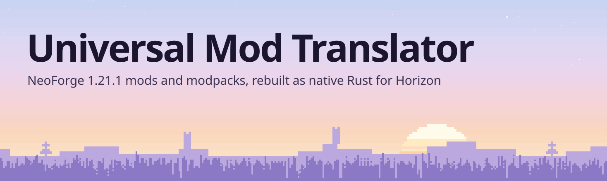
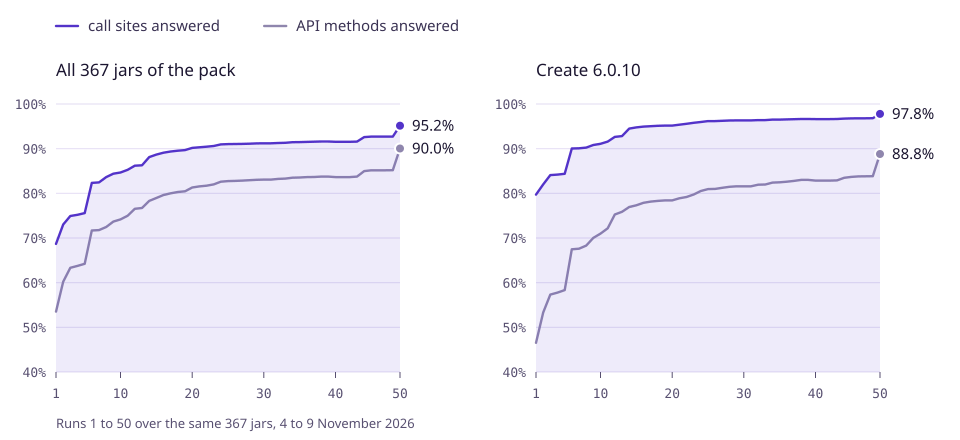
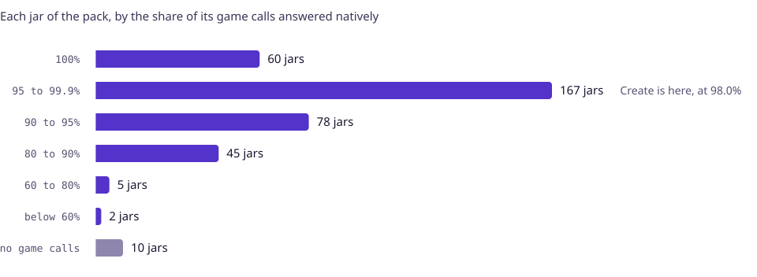
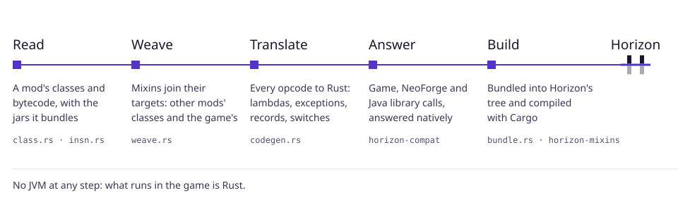

<h1 align="center">
  <picture>
    <source media="(prefers-color-scheme: dark)" srcset="https://github.com/GUNNA-at/horizon-mod-translator/raw/mod-translator/docs/translator/masthead-dark.svg">
    
  </picture>
</h1>

<p align="center"><b>English</b> · <a href="README.ru.md">Русский</a></p>

Universal Mod Translator takes a NeoForge 1.21.1 mod, or a whole modpack, and rebuilds it as native Rust that
runs inside [Horizon](https://github.com/horizon-rust/horizon), the Rust rewrite of Minecraft: Java Edition.
No JVM runs at any point. The mods' bytecode, their mixins and the libraries they bundle become Rust, and a
runtime written in Rust answers their calls into Minecraft, NeoForge and Java. It is meant for any mod, not
a list of supported ones. Create and its addons are the test case.

<!-- progress:headline -->
**91.1%** of the Minecraft and NeoForge methods that the pack's 367 jars call are answered natively, and **95.6%** of their call sites. Java's libraries: **94.3%** of the calls. Create alone: **98.0%** of its call sites. Run 51, 9 November 2026.
<!-- /progress -->

| If you were shown this | If you work on Horizon |
|---|---|
| [Where it stands](#where-it-stands): the numbers, run by run | [How it works](#how-it-works): from a jar to the game |
| [What works in the game](#what-works-in-the-game) | [Where the translator stops and Horizon begins](#where-the-translator-stops-and-horizon-begins) |
| [Try it](#try-it) | [How the numbers are checked](#how-the-numbers-are-checked) and [open gaps](#open-gaps) |

## Where it stands

<picture>
  <source media="(prefers-color-scheme: dark)" srcset="https://github.com/GUNNA-at/horizon-mod-translator/raw/mod-translator/docs/translator/progress-dark.svg">
  
</picture>

<sub>**Figure 1.** Each run translates the same 367 jars of a CurseForge pack (Create Ultimate Selection 2,
Create Aeronautics and their addons). For every Minecraft and NeoForge method a jar calls, a probe asks the
runtime whether it answers it. *Methods* counts each method once per jar. *Call sites* counts every place the
code calls one. The step at run 6 is the probe starting to call through a game host. From run 40 on, it calls
instance methods only on real objects, so a few counted answers were taken back. The step at run 50 is the
game's own code: a method the runtime doesn't have counts when the game's own method, translated from the
player's NeoForge install, can answer it.</sub>

<!-- progress:table -->
| Run 51, 367 jars | Methods answered | Call sites answered |
|---|---:|---:|
| Minecraft and NeoForge API | **91.1%**<br><sub>118,625 of 130,262</sub> | **95.6%**<br><sub>356,370 of 372,790</sub> |
| …of it by the game's own code<br><sub>translated from the player's NeoForge install</sub> | **6.0%**<br><sub>7,768 of 130,262</sub> | **2.9%**<br><sub>10,882 of 372,790</sub> |
| Java libraries<br><sub>JDK, Guava, Gson, fastutil, JOML and the rest</sub> | **83.5%**<br><sub>61,862 of 74,081</sub> | **94.3%**<br><sub>336,967 of 357,517</sub> |
| Create 6.0.10, its API calls | **89.8%**<br><sub>3,570 of 3,976</sub> | **98.0%**<br><sub>24,731 of 25,245</sub> |
| Create 6.0.10, its library calls | **82.8%**<br><sub>1,326 of 1,602</sub> | **97.5%**<br><sub>14,053 of 14,416</sub> |
<!-- /progress -->

<picture>
  <source media="(prefers-color-scheme: dark)" srcset="https://github.com/GUNNA-at/horizon-mod-translator/raw/mod-translator/docs/translator/jars-dark.svg">
  
</picture>

<sub>**Figure 2.** The same run, jar by jar. A jar with no game calls is a library or a pack of data. The
skyline at the top of this page is this run too: one column per jar in alphabetical order, its height the
jar's number of game calls on a log scale, the checkered top the share not answered yet.</sub>

<details>
<summary>Every run</summary>

<!-- progress:history -->
| Run | Date | API methods | Call sites | Create, call sites |
|---:|---|---:|---:|---:|
| 51 | 2026-11-09 | 91.1% | 95.6% | 98.0% |
| 50 | 2026-11-09 | 90.0% | 95.2% | 97.8% |
| 49 | 2026-11-09 | 85.2% | 92.7% | 96.8% |
| 48 | 2026-11-09 | 85.2% | 92.7% | 96.8% |
| 47 | 2026-11-09 | 85.2% | 92.7% | 96.8% |
| 46 | 2026-11-09 | 85.2% | 92.7% | 96.8% |
| 44 | 2026-11-08 | 85.0% | 92.6% | 96.7% |
| 43 | 2026-11-08 | 83.7% | 91.6% | 96.6% |
| 42 | 2026-11-08 | 83.6% | 91.5% | 96.6% |
| 41 | 2026-11-08 | 83.6% | 91.5% | 96.6% |
| 40 | 2026-11-08 | 83.6% | 91.5% | 96.6% |
| 39 | 2026-11-08 | 83.7% | 91.6% | 96.7% |
| 38 | 2026-11-08 | 83.7% | 91.6% | 96.7% |
| 37 | 2026-11-08 | 83.7% | 91.6% | 96.6% |
| 36 | 2026-11-08 | 83.6% | 91.5% | 96.6% |
| 35 | 2026-11-08 | 83.5% | 91.5% | 96.5% |
| 34 | 2026-11-08 | 83.5% | 91.5% | 96.5% |
| 33 | 2026-11-08 | 83.3% | 91.3% | 96.4% |
| 32 | 2026-11-08 | 83.2% | 91.3% | 96.4% |
| 31 | 2026-11-08 | 83.1% | 91.2% | 96.3% |
| 30 | 2026-11-08 | 83.1% | 91.2% | 96.3% |
| 29 | 2026-11-08 | 83.0% | 91.2% | 96.3% |
| 28 | 2026-11-08 | 82.9% | 91.1% | 96.3% |
| 27 | 2026-11-08 | 82.8% | 91.1% | 96.2% |
| 26 | 2026-11-08 | 82.8% | 91.0% | 96.2% |
| 25 | 2026-11-08 | 82.7% | 91.0% | 96.2% |
| 24 | 2026-11-08 | 82.6% | 90.9% | 96.0% |
| 23 | 2026-11-08 | 82.0% | 90.6% | 95.8% |
| 22 | 2026-11-08 | 81.7% | 90.4% | 95.6% |
| 21 | 2026-11-08 | 81.6% | 90.3% | 95.4% |
| 20 | 2026-11-07 | 81.3% | 90.2% | 95.2% |
| 19 | 2026-11-07 | 80.5% | 89.7% | 95.2% |
| 18 | 2026-11-07 | 80.3% | 89.5% | 95.1% |
| 17 | 2026-11-07 | 80.0% | 89.4% | 95.0% |
| 16 | 2026-11-07 | 79.6% | 89.1% | 94.9% |
| 15 | 2026-11-07 | 79.0% | 88.7% | 94.8% |
| 14 | 2026-11-07 | 78.3% | 88.1% | 94.5% |
| 13 | 2026-11-07 | 76.7% | 86.3% | 92.8% |
| 12 | 2026-11-07 | 76.5% | 86.2% | 92.6% |
| 11 | 2026-11-06 | 75.0% | 85.3% | 91.6% |
| 10 | 2026-11-06 | 74.2% | 84.7% | 91.1% |
| 9 | 2026-11-06 | 73.7% | 84.4% | 90.8% |
| 8 | 2026-11-06 | 72.5% | 83.6% | 90.2% |
| 7 | 2026-11-06 | 71.8% | 82.4% | 90.1% |
| 6 | 2026-11-06 | 71.7% | 82.3% | 90.0% |
| 5 | 2026-11-06 | 64.2% | 75.6% | 84.4% |
| 4 | 2026-11-05 | 63.8% | 75.2% | 84.2% |
| 3 | 2026-11-05 | 63.3% | 74.9% | 84.1% |
| 2 | 2026-11-05 | 60.2% | 73.0% | 82.0% |
| 1 | 2026-11-04 | 53.5% | 68.7% | 79.7% |
<!-- /progress -->

</details>

## What works in the game

Create 6.0.10, translated and built into Horizon, checked in the running game, driven by `horizon-ctl`. Each
result comes from a scene set up by command, read back from the world's data and from screenshots:

- **Blocks.** All 643 of Create's blocks can be set in one world and tick without an error. They render with
  Create's own models.
- **Kinetics.** A creative motor turns shafts, cogwheels, gearboxes and belts. Speedometers and
  stressometers read it, and the goggles show the stress figures.
- **Speed.** A server tick with 1,568 of Create's kinetic block entities (32 rows of 48 shafts, each row
  turned by a creative motor) takes 2.7 ms, 0.5 of it the bare ground: about 1.4 µs per block entity. It
  took 14 ms before the wrapper around each one's tick was cut down (its ticker made once for its block's
  state, its data written when it changed), and 3.6 ms before the API answered the calls mods make most at
  once, as a JIT's intrinsics. The server keeps that speed with the game's window hidden: macOS used to nap
  it after half a minute, 8 to 9 times slower.
- **Dimensions and unloading.** A machine in the Nether and one at the same coordinates in the Overworld
  run apart: a shaft turns at 16 in one and at −16 in the other. Create's block entities leave the world with
  their chunk, as in Minecraft: each is told its chunk unloaded, then removed, and the chunk brings it back
  from its saved data. A field of 1,568 was let go when the player went 4,000 blocks away, and turned at its
  speed again when they came back.
- **Belts.** Items, mobs and players ride a belt at its speed and drop off its end.
- **Processing.** Presses compact over basins with Minecraft's recipes and Create's own. Mixers brew
  potions over lit blaze burners. Fans smelt over lava, smoke over a campfire and wash in water.
- **Fluids.** A pump draws water through pipes into a tank. Spouts fill bottles and buckets on depots, and
  item drains empty them.
- **Logistics and redstone.** Funnels, hoppers, stockpile switches, redstone links, nixie tubes, display
  boards, controller rails, mechanical pistons and rope pulleys.
- **Survival.** Create's advancements, its potato cannon, its toolbox, and its saws' damage.
- **Trains.** A line of track, a station and two carriages, each a bogey with blocks super-glued onto it:
  a click on the station opens Create's assembly screen, and its button makes them a train. `/create
  trains` lists "Unnamed Train, 2 Wagons" waiting at the station, and each carriage is an entity in the
  world, drawn by the client on the rails with its bogey's wheels and the coupling to the next. A right click
  on a carriage's controls takes them, and W drives the train off the station and down the line. A player
  standing on a carriage rides with it: carried along the line, and still on it where the train stops.
- **Other mods' mobs.** Waddles' penguins, summoned by command or hatched from their spawn egg, walk
  their pen by their own AI goals and pathfinding, grow up from babies, and are saved with the world: all
  five came back after it was closed and opened again. The game's commands see them as their own:
  `@e[type=waddles:adelie_penguin]`, `execute as` and `at`, `tp`, `kill` and `data get entity`.
  Players hit and feed them: a punch takes 1 of a penguin's 8 health, a sword kills it, and cod puts a
  grown one in love for 30 seconds and makes a baby grow. Two fed penguins have a baby, the player gets
  the experience and "The Parrots and the Bats". They also spawn on their own, by Waddles' biome modifier
  and spawn rules: 5 came with the snowy plains' chunks beside 4 rabbits, and on an empty snowy field
  natural spawning made 5 penguins and 7 rabbits, then stopped at the creature cap, which counts the
  penguins with the rabbits.
- **From the launcher.** On a fresh launcher, `mods add-java` translated Waddles' jar and `--build` built a
  game with it in 4½ minutes, from this repository's source and its own Rust. That game, started as a player
  starts it, with no developer flags, summons the penguins and hatches them from their egg. Create took 16
  seconds to translate and 4 minutes to build the same way, and its shafts turn in that game. A folder with
  Create and Waddles became an instance of its own (`--new-instance`, or a modpack dropped on the window) and
  played both mods in one world.

Not working yet: NeoForge's config screens, and part of the client's rendering. See [open gaps](#open-gaps). The whole pack has not been run in one game yet.

## Try it

The Horizon launcher on this branch does it in one command: it translates the mod, builds the game with it, and the
instance plays that build. It needs resources prepared from your own Minecraft (see [Horizon's README](../README.md))
and brings its own Rust.

```sh
# The launcher of this branch: it carries the translator.
cargo build --release --manifest-path launcher/Cargo.toml

# A mod's jar, a folder of jars, or a modpack (.mrpack, CurseForge zip or instance folder).
horizon-launcher mods add-java Waddles-neoforge-1.21-0.11.1.jar --build --trust-native-code
horizon-launcher play
```

`add-java` turns on the mod's content (`horizon-mods/`) and its code, translated into Rust
(`horizon-native-mods/<id>_translated/`). `--build` downloads this repository's source at the commit the translator
was built from, applies the bundle with horizon-mixins and compiles the game: 4½ minutes the first time for
Waddles on an M-series Mac, 4 minutes for Create, then only what changed. Without `--build`,
`horizon-launcher native-build --trust-native-code` or the Mods page's Build button does it later.
`--new-instance` gives the mods an instance of their own, named after the pack; a modpack dropped on the launcher's
window does the same.

By hand, a step at a time (what the launcher runs):

```sh
# 1. What a jar needs: every API call it makes, and the share the runtime answers.
cargo run --release -p horizon-mod-translator -- coverage path/to/mod.jar

# 2. Translate a mod, and its addons as one engine, into a bundle.
cargo run --release -p horizon-mod-translator -- bundle create.jar out/ --with addon.jar

# 3. Apply the bundle to a copy of Horizon's tree and build the game.
#    horizon-mixins lives in its own repository (GUNNA-at/horizon-mixins).
horizon-mixins apply --workspace <copy of this tree> \
  --mods <folder with out/, without out/content> --out stage
(cd stage && CARGO_INCREMENTAL=0 cargo build --profile fast -p horizon-client)

# 4. Play. The mod's blocks, items and recipes load from out/content.
horizon-ctl launch --game stage/target/fast/horizon-client --world T --creative \
  --resources <prepared resources> --dev-mod out/content --game-dir <scratch folder>
```

Create alone, with the libraries it bundles, becomes about 1.4 million lines of Rust. Build it without
incremental compilation, and keep 15 GB of disk free.

## How it works

<picture>
  <source media="(prefers-color-scheme: dark)" srcset="https://github.com/GUNNA-at/horizon-mod-translator/raw/mod-translator/docs/translator/pipeline-dark.svg">
  
</picture>

1. **Read.** The class parser and instruction decoder read every class of the jar, and of the jars it bundles
   (`META-INF/jarjar`), with annotations kept for mixins and registration.
2. **Weave.** Mixins are applied as Mixin applies them at class load. A mixin into another mod's class is
   woven into the translated code. One into the game's classes adds its fields and methods to the game's
   objects. Its injectors into the game's own code need hooks in Horizon and are not woven yet.
3. **Translate.** `codegen.rs` turns every opcode into Rust: invokedynamic (lambdas, method references,
   string concatenation), exceptions with their handler tables, records, switches over strings and enums.
4. **Answer.** Calls that leave the mod go to `horizon-compat`. It holds Rust implementations of the
   Minecraft, NeoForge and Java library methods mods use, written against Horizon's engine: registries,
   levels, block states, entities, items, fluids, rendering, networking, collections, streams. Where it has
   no answer, the game's own code can be one: the translator reads the player's NeoForge 1.21.1 install and
   translates, with the mods, the game classes the runtime doesn't model and the methods of those it does
   whose code asks only what is already answered. Nothing of the game is shipped: it comes from the
   player's own jars.
5. **Build.** `bundle` splits the result into crates. Each crate carries its own classes, and the runtime
   links them as the game starts, resolving each virtual call as the JVM does. The engine over the crates stays
   small however many mods are translated together. `horizon-mixins` applies the bundle at Horizon's native
   hooks, and Cargo compiles it into the game with everything else.

## Where the translator stops and Horizon begins

| Part | Owns |
|---|---|
| [`horizon-mod-translator`](../crates/horizon-mod-translator) | Reading jars, weaving mixins, translating bytecode, bundling, and the `coverage` report |
| [`horizon-compat-core`](../crates/horizon-compat-core) | The runtime's object model: values, heap, the class space linked at run time, the host interface. A change here rebuilds every translated engine |
| [`horizon-compat`](../crates/horizon-compat) | The Java API surface mods call, in Rust, mapped onto Horizon |
| `horizon-mixins` | Applying bundles to a copy of Horizon's tree at its native hooks (`native-hooks.json`) |
| [`horizon-port-pack`](../crates/horizon-port-pack) | A pack's content: assets, data, recipes, loot tables, tags, worldgen |
| Horizon | The engine. It gets general hooks (`tools/native-hook-fragments/`), never code for one mod |

About 183,000 lines of Rust across the three crates, most of it the API surface. Mojang's and the mods'
files are never committed. Every translation is built from the user's own jars.

## How the numbers are checked

- **The pack runs.** `coverage` runs on each jar of the pack. Calls into datagen-only APIs (data providers,
  model generators) are left out, because a player's game never runs them. The library half (`LIBS=1`)
  measures `java.*`, Guava, Gson, fastutil, JOML and the rest the same way. `tools/translator_progress.py`
  keeps the history in [`docs/translator/progress.json`](../docs/translator/progress.json) and draws the
  figures above.
- **The specification.** Behaviour is checked against NeoForge 21.1.256's and Minecraft 1.21.1's bytecode
  (`javap`), against the libraries' own jars, and against JDK 21 oracles for `java.*`.
- **Tests.** `horizon-compat` has 745 unit tests. The translator's tests include a differential test: the
  same Java runs on the JVM and translated, and the results must match bit for bit.
- **In the game.** Scenes are set up and read back with `horizon-ctl`: block and entity data, and
  screenshots.

## Open gaps

The API methods the most jars still miss, from the latest run:

<!-- progress:gaps -->
| Missing API method | Jars | Call sites |
|---|---:|---:|
| `Minecraft.getTextureManager()` | 46 | 106 |
| `RenderSystem.getModelViewStack()` | 24 | 40 |
| `TextureManager.register(ResourceLocation, AbstractTexture)` | 24 | 40 |
| `Level.broadcastEntityEvent(Entity, byte)` | 22 | 78 |
| `new DynamicTexture(NativeImage)` | 22 | 39 |
| `ChunkMap.getPlayers(ChunkPos, boolean)` | 21 | 31 |
| `PlayerEvent.PlayerChangedDimensionEvent.getEntity()` | 21 | 22 |
| `MinecraftServer.reloadableRegistries()` | 20 | 43 |
<!-- /progress -->

<details>
<summary>The library methods the most jars still miss</summary>

<!-- progress:lib_gaps -->
| Missing library method | Jars | Call sites |
|---|---:|---:|
| `Method.invoke(Object, Object[])` | 57 | 126 |
| `Class.getDeclaredFields()` | 45 | 84 |
| `Field.getType()` | 43 | 94 |
| `Gson.fromJson(Reader, Class)` | 40 | 55 |
| `Gson.fromJson(String, Class)` | 35 | 68 |
| `Modifier.isStatic(int)` | 34 | 65 |
| `Array.newInstance(Class, int)` | 33 | 62 |
| `new FileWriter(File)` | 33 | 46 |
<!-- /progress -->

</details>

## The log

Every step is a numbered Part in [`docs/mod-translator.md`](../docs/mod-translator.md): what it changed,
what it was checked against, and the run that measured it.

<sub>This branch is a fork of [Horizon](https://github.com/horizon-rust/horizon), and Horizon's own README
is [here](../README.md). The figures use Horizon's design system and its fonts: Geist, Geist Mono and
Bricolage Grotesque (SIL OFL 1.1). After a pack run, refresh them with
`python3 tools/translator_progress.py record <run dir>` and then `render`.</sub>
