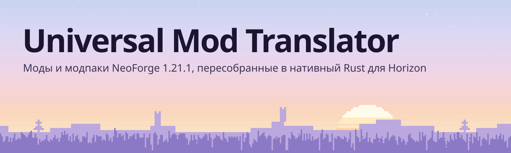
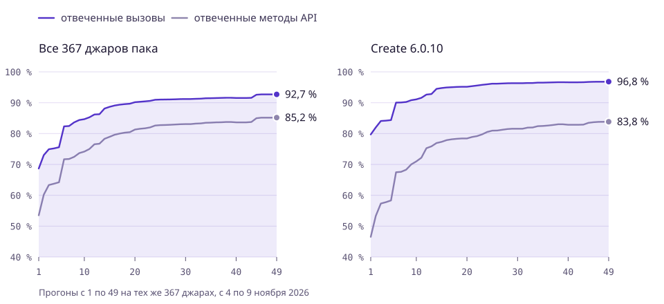
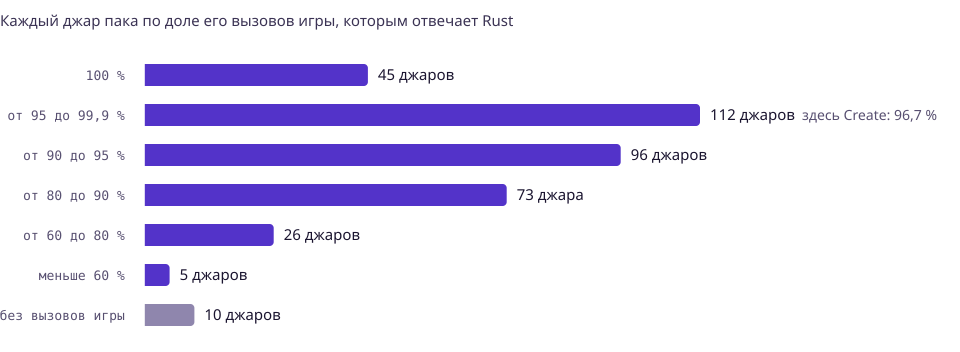
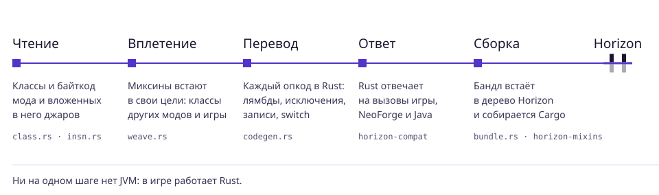

<h1 align="center">
  <picture>
    <source media="(prefers-color-scheme: dark)" srcset="https://github.com/GUNNA-at/horizon-mod-translator/raw/mod-translator/docs/translator/masthead-ru-dark.svg">
    
  </picture>
</h1>

<p align="center"><a href="README.md">English</a> · <b>Русский</b></p>

Universal Mod Translator берёт мод для NeoForge 1.21.1 или целый модпак и пересобирает его в нативный Rust,
который работает внутри [Horizon](https://github.com/horizon-rust/horizon), переписанного на Rust Minecraft:
Java Edition. JVM не запускается ни на одном шаге. Байткод модов, их миксины и вложенные в них библиотеки
становятся Rust, а рантайм на Rust отвечает на их вызовы в Minecraft, NeoForge и Java. Переводчик делается
для любого мода, а не для списка поддерживаемых. Create и аддоны к нему служат проверкой.

<!-- progress:headline -->
Rust отвечает на **85,0 %** методов Minecraft и NeoForge, которые вызывают 367 джаров пака, это **92,6 %** мест вызова. Библиотеки Java: **94,3 %** вызовов. Create: **96,7 %** его вызовов. Прогон 44, 8 ноября 2026.
<!-- /progress -->

| Если вам это показали | Если вы работаете над Horizon |
|---|---|
| [Где мы сейчас](#где-мы-сейчас): цифры, прогон за прогоном | [Как это работает](#как-это-работает): от джара до игры |
| [Что работает в игре](#что-работает-в-игре) | [Где кончается переводчик и начинается Horizon](#где-кончается-переводчик-и-начинается-horizon) |
| [Попробовать](#попробовать) | [Как проверяются цифры](#как-проверяются-цифры) и [чего ещё нет](#чего-ещё-нет) |

## Где мы сейчас

<picture>
  <source media="(prefers-color-scheme: dark)" srcset="https://github.com/GUNNA-at/horizon-mod-translator/raw/mod-translator/docs/translator/progress-ru-dark.svg">
  
</picture>

<sub>**Рисунок 1.** Каждый прогон переводит одни и те же 367 джаров пака с CurseForge (Create Ultimate
Selection 2, Create Aeronautics и аддоны к ним). Для каждого метода Minecraft и NeoForge, который вызывает
джар, проба спрашивает рантайм, отвечает ли он на него. *Методы* считают каждый метод один раз на джар.
*Вызовы* считают каждое место в коде, где он вызывается. Ступенька на прогоне 6: проба начала вызывать
через хост игры. С прогона 40 она вызывает методы экземпляра только на настоящих объектах, поэтому
несколько засчитанных ответов сняты.</sub>

<!-- progress:table -->
| Прогон 44, 367 джаров | Отвечено методов | Отвечено вызовов |
|---|---:|---:|
| API Minecraft и NeoForge | **85,0 %**<br><sub>110 665 из 130 223</sub> | **92,6 %**<br><sub>345 142 из 372 742</sub> |
| Библиотеки Java<br><sub>JDK, Guava, Gson, fastutil, JOML и другие</sub> | **83,5 %**<br><sub>61 858 из 74 081</sub> | **94,3 %**<br><sub>336 963 из 357 517</sub> |
| Create 6.0.10, вызовы API | **83,5 %**<br><sub>3 315 из 3 971</sub> | **96,7 %**<br><sub>24 416 из 25 240</sub> |
| Create 6.0.10, вызовы библиотек | **82,7 %**<br><sub>1 325 из 1 602</sub> | **97,5 %**<br><sub>14 052 из 14 416</sub> |
<!-- /progress -->

<picture>
  <source media="(prefers-color-scheme: dark)" srcset="https://github.com/GUNNA-at/horizon-mod-translator/raw/mod-translator/docs/translator/jars-ru-dark.svg">
  
</picture>

<sub>**Рисунок 2.** Тот же прогон, по джарам. Джар без вызовов игры это библиотека или набор данных. Город
на горизонте вверху страницы тоже этот прогон: по столбику на джар в алфавитном порядке, высота это число
вызовов игры в логарифмическом масштабе, клетчатая верхушка это доля, на которую ответа ещё нет.</sub>

<details>
<summary>Все прогоны</summary>

<!-- progress:history -->
| Прогон | Дата | Методы API | Вызовы | Create, вызовы |
|---:|---|---:|---:|---:|
| 44 | 2026-11-08 | 85,0 % | 92,6 % | 96,7 % |
| 43 | 2026-11-08 | 83,7 % | 91,6 % | 96,6 % |
| 42 | 2026-11-08 | 83,6 % | 91,5 % | 96,6 % |
| 41 | 2026-11-08 | 83,6 % | 91,5 % | 96,6 % |
| 40 | 2026-11-08 | 83,6 % | 91,5 % | 96,6 % |
| 39 | 2026-11-08 | 83,7 % | 91,6 % | 96,7 % |
| 38 | 2026-11-08 | 83,7 % | 91,6 % | 96,7 % |
| 37 | 2026-11-08 | 83,7 % | 91,6 % | 96,6 % |
| 36 | 2026-11-08 | 83,6 % | 91,5 % | 96,6 % |
| 35 | 2026-11-08 | 83,5 % | 91,5 % | 96,5 % |
| 34 | 2026-11-08 | 83,5 % | 91,5 % | 96,5 % |
| 33 | 2026-11-08 | 83,3 % | 91,3 % | 96,4 % |
| 32 | 2026-11-08 | 83,2 % | 91,3 % | 96,4 % |
| 31 | 2026-11-08 | 83,1 % | 91,2 % | 96,3 % |
| 30 | 2026-11-08 | 83,1 % | 91,2 % | 96,3 % |
| 29 | 2026-11-08 | 83,0 % | 91,2 % | 96,3 % |
| 28 | 2026-11-08 | 82,9 % | 91,1 % | 96,3 % |
| 27 | 2026-11-08 | 82,8 % | 91,1 % | 96,2 % |
| 26 | 2026-11-08 | 82,8 % | 91,0 % | 96,2 % |
| 25 | 2026-11-08 | 82,7 % | 91,0 % | 96,2 % |
| 24 | 2026-11-08 | 82,6 % | 90,9 % | 96,0 % |
| 23 | 2026-11-08 | 82,0 % | 90,6 % | 95,8 % |
| 22 | 2026-11-08 | 81,7 % | 90,4 % | 95,6 % |
| 21 | 2026-11-08 | 81,6 % | 90,3 % | 95,4 % |
| 20 | 2026-11-07 | 81,3 % | 90,2 % | 95,2 % |
| 19 | 2026-11-07 | 80,5 % | 89,7 % | 95,2 % |
| 18 | 2026-11-07 | 80,3 % | 89,5 % | 95,1 % |
| 17 | 2026-11-07 | 80,0 % | 89,4 % | 95,0 % |
| 16 | 2026-11-07 | 79,6 % | 89,1 % | 94,9 % |
| 15 | 2026-11-07 | 79,0 % | 88,7 % | 94,8 % |
| 14 | 2026-11-07 | 78,3 % | 88,1 % | 94,5 % |
| 13 | 2026-11-07 | 76,7 % | 86,3 % | 92,8 % |
| 12 | 2026-11-07 | 76,5 % | 86,2 % | 92,6 % |
| 11 | 2026-11-06 | 75,0 % | 85,3 % | 91,6 % |
| 10 | 2026-11-06 | 74,2 % | 84,7 % | 91,1 % |
| 9 | 2026-11-06 | 73,7 % | 84,4 % | 90,8 % |
| 8 | 2026-11-06 | 72,5 % | 83,6 % | 90,2 % |
| 7 | 2026-11-06 | 71,8 % | 82,4 % | 90,1 % |
| 6 | 2026-11-06 | 71,7 % | 82,3 % | 90,0 % |
| 5 | 2026-11-06 | 64,2 % | 75,6 % | 84,4 % |
| 4 | 2026-11-05 | 63,8 % | 75,2 % | 84,2 % |
| 3 | 2026-11-05 | 63,3 % | 74,9 % | 84,1 % |
| 2 | 2026-11-05 | 60,2 % | 73,0 % | 82,0 % |
| 1 | 2026-11-04 | 53,5 % | 68,7 % | 79,7 % |
<!-- /progress -->

</details>

## Что работает в игре

Create 6.0.10, переведённый и собранный в Horizon, проверен в запущенной игре через `horizon-ctl`. Каждый
результат взят из сцены, выставленной командами: данные мира прочитаны обратно, сняты скриншоты.

- **Блоки.** Все 643 блока Create ставятся в один мир и тикают без ошибок. Они рисуются собственными
  моделями Create.
- **Кинетика.** Творческий мотор крутит валы, шестерни, коробки передач и ремни. Спидометры и
  стрессометры это показывают, а очки показывают нагрузку.
- **Ремни.** Предметы, мобы и игроки едут по ремню с его скоростью и сходят с конца.
- **Обработка.** Прессы прессуют над чашами по рецептам Minecraft и самого Create. Миксеры варят зелья над
  зажжёнными горелками ифрита. Вентиляторы плавят над лавой, коптят над костром и промывают в воде.
- **Жидкости.** Помпа качает воду по трубам в бак. Носики наполняют бутылки и вёдра на подставках, а
  сливы предметов их опустошают.
- **Логистика и редстоун.** Воронки, загрузчики, переключатели запасов, редстоун-связи, никси-трубки,
  табло, рельсы-контроллеры, механические поршни и верёвочные шкивы.
- **Выживание.** Достижения Create, картофельная пушка, ящик для инструментов и урон пил.
- **Мобы других модов.** Пингвины Waddles появляются командой или из своего яйца призыва, ходят по
  загону по собственным целям ИИ и поиску пути, вырастают из малышей и сохраняются вместе с миром: все
  пять вернулись после того, как мир закрыли и открыли снова.
- **Из лаунчера.** В чистом лаунчере `mods add-java` перевёл джар Waddles, а `--build` собрал с ним игру
  за 4,5 минуты из исходников этого репозитория и своего Rust. Эта игра, запущенная так, как её запускает
  игрок, без флагов разработчика, призывает пингвинов и выводит их из яйца.

Пока не работает: поезда, удары и кормление мобов из других модов, их естественное появление, экраны
настроек NeoForge и часть отрисовки клиента.
Подробнее в разделе [чего ещё нет](#чего-ещё-нет). Весь пак целиком в одной игре ещё не запускался.

## Попробовать

Лаунчер Horizon из этой ветки делает всё одной командой: переводит мод, собирает с ним игру, и экземпляр
играет в эту сборку. Нужны ресурсы, подготовленные из вашей собственной установки Minecraft (см.
[README Horizon](../README.md)); Rust лаунчер приносит сам.

```sh
# Лаунчер этой ветки: переводчик у него внутри.
cargo build --release --manifest-path launcher/Cargo.toml

# Джар мода, папка джаров или модпак (.mrpack, zip или папка экземпляра CurseForge).
horizon-launcher mods add-java Waddles-neoforge-1.21-0.11.1.jar --build --trust-native-code
horizon-launcher play
```

`add-java` включает содержимое мода (`horizon-mods/`) и его код, переведённый в Rust
(`horizon-native-mods/<id>_translated/`). `--build` скачивает исходники этого репозитория на том коммите, из
которого собран переводчик, накладывает бандл через horizon-mixins и компилирует игру: в первый раз 4,5 минуты
для Waddles на Mac с процессором M, для Create намного дольше, дальше только изменённое. Без `--build` то же сделает позже `horizon-launcher native-build
--trust-native-code` или кнопка Build на странице модов.

Вручную, по шагам (то, что запускает лаунчер):

```sh
# 1. Что нужно джару: каждый его вызов API и доля, на которую отвечает рантайм.
cargo run --release -p horizon-mod-translator -- coverage path/to/mod.jar

# 2. Перевести мод, а его аддоны вместе с ним одним движком, в бандл.
cargo run --release -p horizon-mod-translator -- bundle create.jar out/ --with addon.jar

# 3. Наложить бандл на копию дерева Horizon и собрать игру.
#    horizon-mixins живёт в своём репозитории (GUNNA-at/horizon-mixins).
horizon-mixins apply --workspace <копия этого дерева> \
  --mods <папка с out/ без out/content> --out stage
(cd stage && CARGO_INCREMENTAL=0 cargo build --profile fast -p horizon-client)

# 4. Играть. Блоки, предметы и рецепты мода грузятся из out/content.
horizon-ctl launch --game stage/target/fast/horizon-client --world T --creative \
  --resources <подготовленные ресурсы> --dev-mod out/content --game-dir <временная папка>
```

Один Create вместе со своими библиотеками превращается примерно в 1,4 миллиона строк Rust. Собирайте его
без инкрементальной компиляции и держите свободными 15 ГБ диска.

## Как это работает

<picture>
  <source media="(prefers-color-scheme: dark)" srcset="https://github.com/GUNNA-at/horizon-mod-translator/raw/mod-translator/docs/translator/pipeline-ru-dark.svg">
  
</picture>

1. **Чтение.** Парсер классов и декодер инструкций читают каждый класс джара и вложенных в него джаров
   (`META-INF/jarjar`). Аннотации сохраняются для миксинов и регистрации.
2. **Вплетение.** Миксины применяются так же, как их применяет Mixin при загрузке класса. Миксин в класс
   другого мода вплетается в переведённый код. Миксин в классы игры добавляет свои поля и методы её
   объектам. Его инжекторы в собственный код игры требуют хуков в Horizon и пока не вплетаются.
3. **Перевод.** `codegen.rs` превращает каждый опкод в Rust: invokedynamic (лямбды, ссылки на методы,
   склейку строк), исключения с их таблицами обработчиков, записи, switch по строкам и перечислениям.
4. **Ответ.** Вызовы, которые выходят за пределы мода, попадают в `horizon-compat`. Там лежат реализации
   на Rust методов Minecraft, NeoForge и библиотек Java, которыми пользуются моды. Они написаны поверх
   движка Horizon: реестры, уровни, состояния блоков, сущности, предметы, жидкости, отрисовка, сеть,
   коллекции, стримы.
5. **Сборка.** `bundle` раскладывает результат по крейтам. `horizon-mixins` встраивает его в нативные хуки
   Horizon, и Cargo компилирует его в игру вместе со всем остальным.

## Где кончается переводчик и начинается Horizon

| Часть | Что за ней |
|---|---|
| [`horizon-mod-translator`](../crates/horizon-mod-translator) | Чтение джаров, вплетение миксинов, перевод байткода, бандлы и отчёт `coverage` |
| [`horizon-compat-core`](../crates/horizon-compat-core) | Объектная модель рантайма: значения, куча, таблицы диспетчеризации, интерфейс хоста. Изменение здесь пересобирает каждый переведённый движок |
| [`horizon-compat`](../crates/horizon-compat) | Поверхность Java API, которую вызывают моды, на Rust и поверх Horizon |
| `horizon-mixins` | Наложение бандлов на копию дерева Horizon в его нативных хуках (`native-hooks.json`) |
| [`horizon-port-pack`](../crates/horizon-port-pack) | Контент пака: ассеты, данные, рецепты, таблицы лута, теги, генерация мира |
| Horizon | Движок. Он получает общие хуки (`tools/native-hook-fragments/`) и никогда код под один мод |

В трёх крейтах около 168 000 строк Rust, больше всего это поверхность API. Файлы Mojang и модов никогда не
коммитятся. Каждый перевод собирается из джаров самого пользователя.

## Как проверяются цифры

- **Прогоны по паку.** `coverage` запускается на каждом джаре пака. Вызовы API, нужных только для
  генерации данных (провайдеры данных, генераторы моделей), не считаются: игра игрока их никогда не
  запускает. Библиотечная половина (`LIBS=1`) так же меряет `java.*`, Guava, Gson, fastutil, JOML и
  остальные. `tools/translator_progress.py` хранит историю в
  [`docs/translator/progress.json`](../docs/translator/progress.json) и рисует графики выше.
- **Спецификация.** Поведение сверяется с байткодом NeoForge 21.1.256 и Minecraft 1.21.1 (`javap`), с
  джарами самих библиотек и с оракулами на JDK 21 для `java.*`.
- **Тесты.** В `horizon-compat` 704 юнит-теста. Среди тестов переводчика есть дифференциальный: один и
  тот же Java-код выполняется на JVM и в переводе, и результаты должны совпасть до бита.
- **В игре.** Сцены выставляются и читаются обратно через `horizon-ctl`: данные блоков и сущностей,
  скриншоты.

## Чего ещё нет

Методы API, которых не хватает большему числу джаров, по последнему прогону:

<!-- progress:gaps -->
| Метод API, которого нет | Джаров | Вызовов |
|---|---:|---:|
| `Minecraft.getTextureManager()` | 46 | 106 |
| `new ConfigurationScreen(ModContainer, Screen)` | 38 | 38 |
| `RenderSystem.getModelViewStack()` | 24 | 40 |
| `TextureManager.register(ResourceLocation, AbstractTexture)` | 24 | 40 |
| `RegisterClientTooltipComponentFactoriesEvent.register(Class, Function)` | 23 | 23 |
| `Level.broadcastEntityEvent(Entity, byte)` | 22 | 78 |
| `new DynamicTexture(NativeImage)` | 22 | 39 |
| `ChunkMap.getPlayers(ChunkPos, boolean)` | 21 | 31 |
<!-- /progress -->

<details>
<summary>Методы библиотек, которых не хватает большему числу джаров</summary>

<!-- progress:lib_gaps -->
| Метод библиотеки, которого нет | Джаров | Вызовов |
|---|---:|---:|
| `Method.invoke(Object, Object[])` | 57 | 126 |
| `Class.getDeclaredFields()` | 45 | 84 |
| `Field.getType()` | 43 | 94 |
| `Gson.fromJson(Reader, Class)` | 40 | 55 |
| `Gson.fromJson(String, Class)` | 35 | 68 |
| `Modifier.isStatic(int)` | 34 | 65 |
| `Array.newInstance(Class, int)` | 33 | 62 |
| `new FileWriter(File)` | 33 | 46 |
<!-- /progress -->

</details>

## Журнал

Каждый шаг описан как пронумерованная часть (Part) в [`docs/mod-translator.md`](../docs/mod-translator.md):
что она изменила, с чем сверялась и какой прогон её измерил.

<sub>Эта ветка является форком [Horizon](https://github.com/horizon-rust/horizon), собственный README Horizon
[здесь](../README.md). Графики сделаны в дизайн-системе Horizon и его шрифтами: Geist, Geist Mono и
Bricolage Grotesque (SIL OFL 1.1). После прогона по паку обновите их командами
`python3 tools/translator_progress.py record <папка прогона>` и `render`.</sub>
